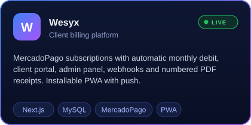
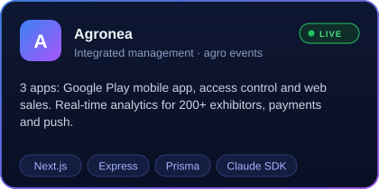
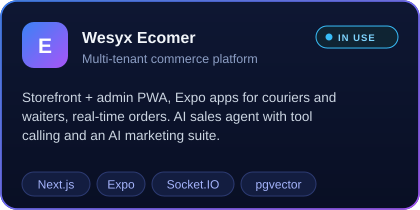
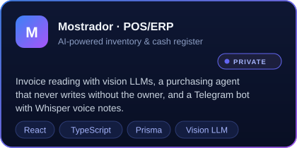
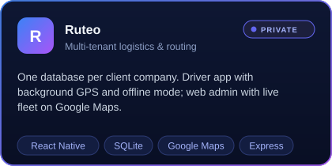
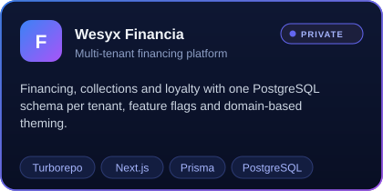
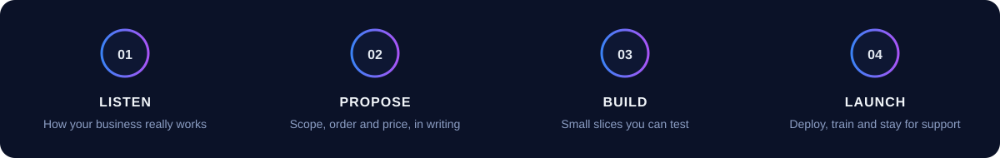

  

  
  
  
  

 

### 👋 About me

I'm **Ricardo**, a **Full Stack & AI Engineer** from **Charata, Chaco, Argentina** (working remote) and the founder of **[Wesyx](https://wesyx.com)**, a custom software studio.

I own products **end to end** — from the data model and the API to the screen people actually work in, and the server it runs on. Since **2022** I've delivered software and AI solutions for **30+ business clients** in retail, distribution, fintech and e‑commerce, mostly **multi‑tenant SaaS**.

I start with how the business really works, talk directly with the people who use what I build, and ship in small slices.

- 🧠 **AI is core leverage:** Claude Code with custom skills is my main workflow — and I review everything before it ships
- 🤖 LLM features in production: agents with tool calling, RAG, MCP servers, vision and voice
- 🏗️ Multi‑tenant architecture: schema‑per‑tenant, feature flags, domain‑based theming, monorepos
- 💳 Payments and integrations: MercadoPago subscriptions, webhooks, WhatsApp, push notifications

 

### 🏗️ Production systems

  
  
  
  
  
  

Most of this runs privately for clients — happy to walk you through it on a call.

### 🤖 AI engineering

  
  
  
  
  
  
  

### ⚡ Tech stack

  

<table align="center">
  <tr>
    <td align="center"><b>Frontend</b> React · TypeScript · Next.js · Vite</td>
    <td align="center"><b>Mobile</b> React Native · Expo</td>
    <td align="center"><b>Backend</b> Node.js · Express · Python · Django · PHP</td>
    <td align="center"><b>Data</b> PostgreSQL · Prisma · MySQL · MongoDB</td>
    <td align="center"><b>Ops</b> Docker · GCP · Nginx · PM2 · Turborepo</td>
  </tr>
</table>

### 🧭 How I work

### 🎓 Education

| | |
|---|---|
| 💻 **Diploma in Full Stack Web Development** | UTN — Facultad Regional Resistencia |
| 🐍 **Diploma in Web Development with Python, Django & MySQL** | Informatorio Chaco · 2023 |

Languages: Spanish (native) · English (reads and writes technical documentation)

### 📫 Let's build something

  Have a process that deserves better software — or an idea that needs AI done right? <b><a href="mailto:ricardoamena@gmail.com">Write me</a></b>, I reply personally.
    
  

